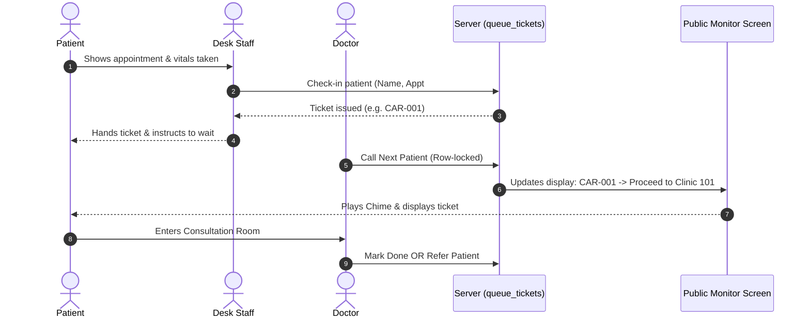
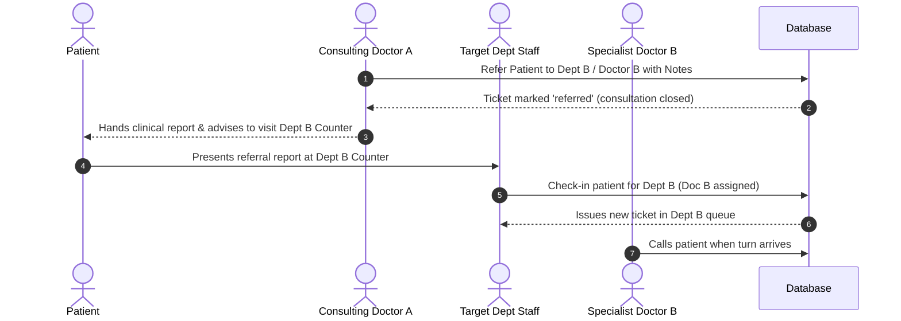

# Hospital Queueing System (Role-Based Multi-Portal)

A modern, full-featured web-based queue management, clinical triage, and counter consultation system developed for hospitals and clinics. Built with **PHP 8**, **MySQL / MariaDB**, **Vanilla JavaScript (ES6)**, and **CSS3**, this application provides dedicated role-based portals for **Hospital Administrators**, **Department Desk Staff**, and **Consulting Doctors**, backed by a public queue display monitor, real-time session tracking, and clinical referral workflows.

---

## 📋 Table of Contents

- [Overview & Three Roles](#-overview--three-roles)
- [System Architecture & Portals](#-system-architecture--portals)
- [Project Structure](#-project-structure)
- [Installation & Setup](#-installation--setup)
- [Database Migrations & Data Reset](#-database-migrations--data-reset)
- [Default Login Credentials](#-default-login-credentials)
- [Role Workflows](#-role-workflows)
- [API Reference & Access Control](#-api-reference--access-control)
- [Security & Concurrency Handling](#-security--concurrency-handling)
- [Automated Acceptance Testing](#-automated-acceptance-testing)

---

## 👥 Overview & Three Roles

The system enforces strict role-based access control (RBAC) both in the frontend and on every backend API endpoint:

### 1. 🛡️ Hospital Administrator (`role: admin`)
- **Live Operations Overview**: Real-time KPI metrics (total active doctors, active staff, currently online users, waiting patients, serving patients, completed, referred, no-show, cancelled today).
- **Live Personnel Attendance & Status**: Real-time roster showing login/logout timestamps and green "Online" / grey "Offline" indicator (updated via 30s heartbeats, detected offline after 90s of inactivity).
- **Department Queue Breakdown**: Real-time table of waiting, serving, completed counts, staff counts, and doctor counts per department.
- **Cross-Department Patient History**: Complete clinical audit trail across all departments with filters by date range, department, doctor, status, and patient search, with **CSV** and printable **PDF / Report** export.
- **Staff Management**: Create desk staff accounts (min. 8 character password), edit names/departments, change passwords, and activate/deactivate accounts.
- **Doctor Management**: Create consulting physician accounts (full name, specialization, department, room/window label, username, min. 8 char password), edit profiles, and activate/deactivate accounts.
- **Attendance Logs**: Comprehensive session history with login/logout timestamps, duration formatting, and user type filtering.
- *Restrictions*: Blocked from queue calling and patient check-in.

### 2. 💼 Department Desk Staff (`role: staff`)
- **Patient Check-In & Registration**: Counter staff register arriving patients with appointment number, patient full name, age (optional), gender (Male/Female/Other), weight (kg), blood pressure (systolic/diastolic, validated format and systolic > diastolic), priority triage flag (Emergency, Senior, PWD, Pregnant), and **mandatory assigned consulting doctor** from the staff member's department.
- **Direct Queue Routing**: Issued ticket (`CAR-001`, `P-002`, etc.) goes directly into the assigned doctor's private waiting queue.
- **Personal Check-In Summary**: History tab displays **counts only** of patients registered by this staff member (Today, This Week, This Month, All-Time Total, and Custom Date Range filter). No medical or patient lists are exposed to desk staff.
- **Profile**: Read-only staff credentials, department name, and assigned counter window.
- *Restrictions*: Blocked from calling queues, completing tickets, doctor referrals, and staff/doctor management.

### 3. 🩺 Consulting Doctor (`role: doctor`)
- **Doctor Queue Control**: Scoped strictly to patients assigned to this doctor. Displays real-time waiting count and waiting list.
- **Active Consultation Card**: Shows currently serving ticket with full triage details (patient name, appointment number, age, gender, BP, weight, priority flag, and referral background if previously referred).
- **Concurrency-Safe Queue Calling**: "Call Next" uses database row-locking (`SELECT ... FOR UPDATE`) to prevent double-calling, automatically completes the doctor's previously serving patient, and calls the next waiting patient in priority-first order (`is_priority DESC, created_at ASC`).
- **Consultation Controls**: Mark as **Done (Completed)**, **Recall** patient, mark as **No Show**, or **Cancel**.
- **Patient Referral**: Refer an active patient to **Another Doctor (Same Department)** or **Another Department** with diagnosis notes and priority propagation. Marking as referred closes the consultation and updates the ticket status to `referred` without automatically generating an unverified queue ticket. The patient presents their referral report to the target counter where authorized staff perform triage/check-in.
- **Clinical History**: Dedicated consultation logs for this doctor with status/date filters and CSV/PDF export.
- **Profile**: Displays doctor specialization, department, assigned consultation room, and username.
- *Restrictions*: Blocked from patient check-in and staff/doctor administration.

### 4. 📺 Public Queue Monitor (`public`)
- **Privacy-Preserving Display**: Accessible publicly at `/monitor`. Displays **only** Ticket Number, Counter Window / Doctor Room Label (e.g., `Proceed to Clinic 101`), and Status.
- **Audio Chime**: Automatic chime (`notification.wav`) triggers whenever a ticket is newly called.
- **Live Clock & Background Sync**: Refreshes every 3 seconds without reloading.

---

## 🖥 System Architecture & Portals

| Portal / Route | Target URL | Accessible Roles |
| :--- | :--- | :--- |
| **Public Monitor** | `http://localhost/STI_Queueing-System/monitor` | Public (Unauthenticated) |
| **Unified Login** | `http://localhost/STI_Queueing-System/staff-login` | Public (Redirects based on role) |
| **Duty Attendance Portal** | `http://localhost/STI_Queueing-System/attendance` | `staff`, `doctor` (Timesheet Self Check-In/Out) |
| **Admin Dashboard** | `http://localhost/STI_Queueing-System/admin-dashboard` | `admin` only |
| **Staff Check-In** | `http://localhost/STI_Queueing-System/staff-dashboard` | `staff` only |
| **Doctor Portal** | `http://localhost/STI_Queueing-System/doctor-dashboard` | `doctor` only |

---

## 📁 Project Structure

```
STI_Queueing-System/
├── api/                                # REST-like JSON API Endpoints
│   ├── attendance-checkin.php          # Staff/Doctor: Start duty attendance (timesheet check-in)
│   ├── attendance-checkout.php         # Staff/Doctor: End duty attendance (timesheet check-out)
│   ├── call-next.php                   # Doctor: Row-locked queue call for assigned doctor
│   ├── checkin-patient.php             # Staff: Check-in patient with mandatory doctor selection
│   ├── complete-ticket.php             # Doctor: Mark ticket completed, no-show, or cancelled
│   ├── export-queue-history.php        # Admin/Doctor: Export transaction logs (CSV / PDF)
│   ├── get-admin-overview.php          # Admin: Real-time system metrics, dept breakdown & roster
│   ├── get-attendance.php              # Admin: Paginated attendance logs (Duty & Session subtabs)
│   ├── get-departments.php             # Public/Auth: Retrieve clinical departments list
│   ├── get-doctor-queue.php            # Doctor: Live queue & active patient for logged-in doctor
│   ├── get-doctor-stats.php            # Doctor: Consultation metrics summary
│   ├── get-doctors.php                 # Public/Auth: Retrieve active doctors by department
│   ├── get-my-attendance.php           # Staff/Doctor: Personal duty status, worked hours & log
│   ├── get-queue-history.php           # Admin/Doctor: Filtered & paginated queue history
│   ├── get-queue.php                   # Public: Sanitized monitor queue data (with room labels)
│   ├── get-staff-stats.php             # Staff: Check-in counts only (today/week/month/total)
│   ├── heartbeat.php                   # All Roles: 30s session keepalive & presence tracking
│   ├── login.php                       # Unified authentication for Admin, Staff, and Doctors
│   ├── logout.php                      # Terminate session & update user_sessions logout time
│   ├── manage-doctors.php              # Admin: Doctor CRUD (create, edit, toggle active, delete)
│   ├── manage-staff.php                # Admin: Staff CRUD (create, edit, toggle active, delete)
│   ├── recall-ticket.php               # Doctor: Re-call patient ticket
│   ├── refer-patient.php               # Doctor: Record referral to another doctor/dept
│   └── test.php                        # API health check
├── config/                             # Database Schemas & Migrations
│   ├── database.sql                    # Fresh install schema with all role tables & seed data
│   ├── migration_hospital.sql          # Phase 1 migration (STI to Hospital schema)
│   ├── migration_roles.sql             # Phase 2 migration (Admin, Staff, Doctor RBAC & sessions)
│   ├── migration_attendance_delete.sql # Phase 3 migration (Duty attendance & soft delete columns)
│   ├── reset_data.sql                  # Isolated transaction data wipe (preserves staff & depts)
│   └── reset_to_admin_only.sql         # Clean reset script to Admin-only state
├── css/                                # User Interface Styling
│   ├── style.css                       # Unified hospital styling, responsive grid & modals
│   ├── theme.css                       # Color palette & variables
│   └── fonts.css                       # Typography styles
├── includes/                           # Backend Core Helpers
│   ├── auth.php                        # Session validation, DB re-validation, requireRole, JSON
│   ├── db.php                          # MySQLi database connection (supports port 3307 & 3306)
│   └── db.config.template.php          # Database configuration template
├── js/                                 # Frontend Client JavaScript
│   ├── admin-dashboard.js              # Admin portal tabs, subtabs, delete modal & CRUD
│   ├── attendance.js                   # Duty timer, server-offset clock, self check-in/out
│   ├── doctor-dashboard.js             # Doctor portal queue, vitals, referrals & consultations
│   ├── monitor.js                      # Public monitor polling, chime sound & room display
│   ├── staff-dashboard.js              # Staff check-in form validation & count summary
│   └── staff-login.js                  # Unified login handler and role redirect
├── pages/                              # Server-Rendered HTML/PHP Views
│   ├── admin-dashboard.php             # Administrator portal view
│   ├── attendance.php                  # Duty self check-in/out & personal timesheet view
│   ├── doctor-dashboard.php            # Consulting physician portal view
│   ├── monitor.php                     # Public queue screen view
│   ├── staff-dashboard.php             # Department desk check-in view
│   └── staff-login.php                 # Login form view
├── tests/                              # Automated Acceptance Tests
│   └── test_roles_acceptance.php       # End-to-end 34-point test suite (100% PASS)
├── index.php                           # Root entry point (redirects to /monitor)
├── .htaccess                           # Apache URL rewrite rules
└── README.md                           # Project documentation
```

---

## 🚀 Installation & Setup

### Prerequisites
- **Web Server**: Apache (via XAMPP, WampServer, or standalone Apache 2.4+ with `mod_rewrite` enabled).
- **PHP**: PHP 8.0 or higher with `mysqli`, `curl`, `json`, and `session` extensions.
- **Database**: MySQL 5.7+ or MariaDB 10.4+.

### Step-by-Step Installation

1. **Clone or Copy Repository**:
   Place the project folder into your web server's root directory:
   ```
   c:\xampp\htdocs\STI_Queueing-System
   ```

2. **Database Setup**:
   - Open phpMyAdmin or your MySQL client.
   - Create a new database named `queue_db` with `utf8mb4_unicode_ci` collation:
     ```sql
     CREATE DATABASE queue_db CHARACTER SET utf8mb4 COLLATE utf8mb4_unicode_ci;
     ```
   - Import `config/database.sql`:
     ```bash
     mysql -u root -p -P 3307 queue_db < config/database.sql
     ```
   *(If upgrading an existing installation, execute `config/migration_hospital.sql` followed by `config/migration_roles.sql`).*

3. **Database Configuration**:
   Verify `includes/db.php`:
   - Default host: `127.0.0.1`
   - Default ports: Checks port `3307` (XAMPP MariaDB) with fallback to `3306`.
   - Default database: `queue_db`
   - Default user: `root` (no password).
   - Timezone: Configured to `'Asia/Kolkata'` (`+05:30`).

4. **Verify Apache Rewrite**:
   Ensure `AllowOverride All` is set for your directory in `httpd.conf` so `.htaccess` routes operate smoothly.

---

## 🔑 Default Login Credentials

| Role | Username | Password | Assigned Department | Default Redirect |
| :--- | :--- | :--- | :--- | :--- |
| **Admin** | `admin` | `admin123` | Admin (Window 10) | `/STI_Queueing-System/admin-dashboard` |
| **Desk Staff** | `admission` | `admission123` | Neurology (Window 2) | `/STI_Queueing-System/staff-dashboard` |
| **Desk Staff** | `md` | `password123` | Cardiology (Window 1) | `/STI_Queueing-System/staff-dashboard` |
| **Doctor** | `dr.grant` *(or created via Admin)* | *(min 8 chars)* | Cardiology (Window 1) | `/STI_Queueing-System/doctor-dashboard` |

*Note: New doctors and staff members can be added directly from the Admin Dashboard under the Doctors and Staff tabs.*

---

## 🔄 User Workflows

### 1. Patient Intake & Queueing


### 2. Clinical Referral Workflow


---

## 📡 API Reference & Access Control

| Endpoint | Method | Allowed Roles | Description |
| :--- | :---: | :---: | :--- |
| `/api/login.php` | `POST` | Public | Unified login for admin, staff, and doctors; creates session log |
| `/api/logout.php` | `GET` | Authenticated | Closes active session with timestamp and destroys session |
| `/api/heartbeat.php` | `GET/POST`| Authenticated | Updates `last_seen_at` for online presence tracking (~30s) |
| `/api/get-admin-overview.php`| `GET` | `admin` | Real-time system metrics, department breakdown & personnel roster |
| `/api/manage-doctors.php` | `GET/POST`| `admin` | List, create (min 8 chars), edit, and activate/deactivate doctors |
| `/api/manage-staff.php` | `GET/POST`| `admin` | List, create (min 8 chars), edit, and activate/deactivate staff |
| `/api/get-attendance.php` | `GET` | `admin` | Paginated user session logs with date and role filtering |
| `/api/checkin-patient.php` | `POST` | `staff` | Check-in patient with vitals; assigned doctor mandatory |
| `/api/get-staff-stats.php` | `GET` | `staff` | Returns count-only metrics of patients registered by staff |
| `/api/get-doctor-queue.php` | `GET` | `doctor` | Real-time waiting list and active consultation for doctor |
| `/api/call-next.php` | `POST` | `doctor` | Concurrency-safe call next for doctor's assigned queue |
| `/api/complete-ticket.php` | `POST` | `doctor` | Mark ticket as completed, no-show, or cancelled |
| `/api/recall-ticket.php` | `POST` | `doctor` | Recall serving patient |
| `/api/refer-patient.php` | `POST` | `doctor` | Record referral to target doctor/dept; sets ticket to referred |
| `/api/get-doctor-stats.php` | `GET` | `doctor` | Summary statistics of doctor's consultations |
| `/api/get-queue-history.php`| `GET` | `admin`, `doctor` | Queue transaction logs (Admin: all depts; Doctor: own tickets) |
| `/api/export-queue-history.php`| `GET` | `admin`, `doctor` | Export transaction logs to CSV or printable PDF/Report |
| `/api/get-queue.php` | `GET` | Public | Sanitized queue status for public monitor (medical data omitted) |
| `/api/get-departments.php` | `GET` | Public | List of hospital clinical departments |
| `/api/get-doctors.php` | `GET` | Public | List of active doctors filtered by department |

---

## 🔒 Security & Concurrency Handling

1. **Server-Side Role Enforcement**:
   - Every protected API calls `requireRole(['role'])` via `includes/auth.php`.
   - Unauthorized attempts immediately return `HTTP 403 Forbidden` with JSON error messages.

2. **Concurrency-Safe Queue Calling**:
   - `api/call-next.php` wraps operations inside an InnoDB database transaction:
     ```sql
     START TRANSACTION;
     SELECT id, ticket_number FROM queue_tickets 
     WHERE doctor_id = ? AND status = 'waiting' 
     ORDER BY is_priority DESC, created_at ASC 
     LIMIT 1 FOR UPDATE;
     ```
   - Row-level locking (`FOR UPDATE`) guarantees no two requests can claim the same patient simultaneously.

3. **Real-Time Online Presence Tracking**:
   - Logged-in users execute a lightweight background heartbeat (`/api/heartbeat.php`) every 30 seconds.
   - Personnel are identified as **Online** if:
     ```sql
     logout_at IS NULL AND last_seen_at >= (NOW() - INTERVAL 90 SECOND)
     ```
   - Sessions idle for greater than 10 minutes without heartbeats are lazily closed.

4. **Privacy & Medical Data Protection**:
   - Patient medical vitals (BP, weight, clinical notes) are strictly scoped to the authorized consulting doctor.
   - Public monitor endpoints (`api/get-queue.php`) strip all medical attributes, returning only ticket numbers, room/window labels, and statuses.

---

## 🧪 Automated Acceptance Testing

An automated end-to-end acceptance test suite covering all 14 acceptance criteria is located at `tests/test_roles_acceptance.php`.

To run the full suite:
```bash
php tests/test_roles_acceptance.php
```

### Verified Test Cases:
- **Test 1**: Admin authentication & redirect validation.
- **Test 2**: Admin dashboard real-time overview API.
- **Test 3**: Admin doctor creation with minimum 8-character password.
- **Test 4**: Admin staff creation with validation.
- **Test 5**: Admin attendance logging & duration calculation.
- **Test 6**: Doctor portal authentication & role routing.
- **Test 7**: Staff check-in portal authentication & role routing.
- **Test 8**: Staff patient check-in with mandatory doctor assignment.
- **Test 8b**: Staff history count-only restriction verification.
- **Test 9**: Server-side 403 Forbidden enforcement on role boundaries.
- **Test 10a/10b**: Doctor queue visibility & concurrency-locked Call Next.
- **Test 11**: Public monitor queue data sanitization & room label display.
- **Test 12**: Doctor patient referral without auto-generating duplicate tickets.
- **Test 13**: Doctor consultation history scoped strictly to the doctor.
- **Test 14**: Heartbeat session keepalive and logout termination.

---

## 📄 License
This project is proprietary software developed for hospital queueing and clinical workflow management. All rights reserved.
